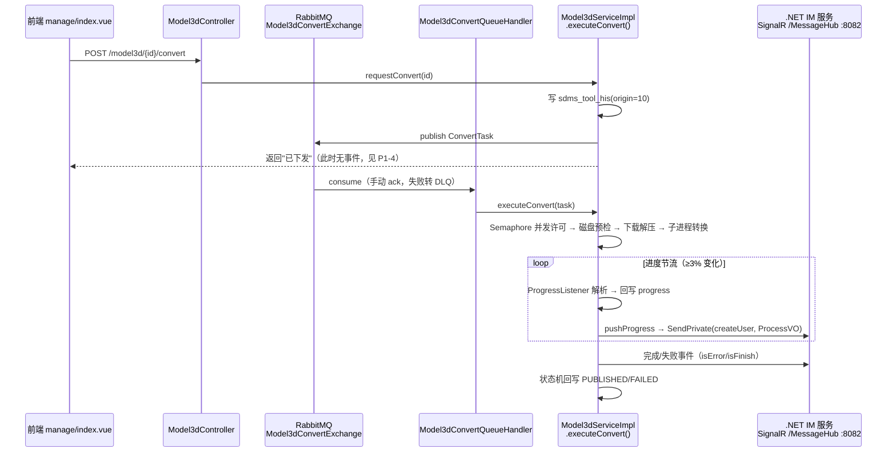
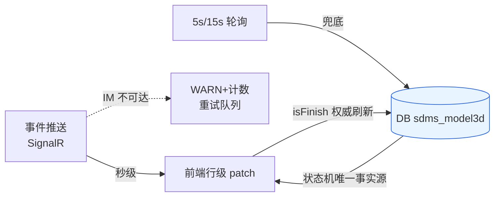

# 三维转换异步任务消息通知技术方案

> 版本：v1.0 ｜ 日期：2026-10-18 ｜ 范围：`Model3dController` / `Model3dServiceImpl` / `SignalrClient` / `geodata-web-ui`（manage、tasks 页）

---

## 1. 结论摘要

1. **不是「只能轮询」——双通道已存在，但实现质量有硬伤。** 现状是「SignalR 事件推送（主）+ 5s 轮询（兜底）」双通道：后端 `Model3dServiceImpl.executeConvert` 每轮进度都通过 `.NET IM 服务（Lri.IMCore，SignalR /MessageHub）` 向创建人推送 `Model3dConvert` 事件，前端 `views/manage/index.vue` 订阅后静默刷新列表。用户感知像纯轮询，是因为推送链路有三个缺陷（见 §3）。
2. **整体技术架构方向合适，不需要另建通道。** MQ 异步转换 + 状态机 + 心跳/看门狗/重启回收 + 事件推送 + 轮询兜底的分层是合理的；问题集中在 `SignalrClient` 连接管理（每次推送新建连接、旧连接不关，P0 泄漏）、事件契约粒度（无业务 id，只能整列表刷新）、覆盖缺口（排队/回收无事件、弹窗打开即停更）。
3. **推荐方案：修复并沿深现有 SignalR 通道，不引入 SSE/自建 WebSocket。** 多副本部署下自建 SSE/WS 会退化成「必须再加 Redis 广播」的重复建设（IM 服务本身就是跨实例路由的现成总线）。改造集中在 2 个后端文件 + 前端 `im.ts` 与 2 个视图（见 §5）。
4. **DB 始终是唯一事实源，消息只做「信号」。** 所有实时性优化不改变以 `sdms_model3d.status/progress` 为准的最终一致性语义，消息丢失最坏退化为 5s 轮询延迟。

---

## 2. 现状链路（已按源码核实）

### 2.1 转换执行链路（事件产生侧）

关键事实：
- 事件载体：`ProcessVO{moduleType="Model3dConvert", content=ProgressInfo{currentStep, currentProgress, currentWork, currentUserId, isError, isFinish, result}}`（`WebSocketUtil.sendMsg` → `SignalrClient.sendPrivate`）。
- 推送时机仅 3 处：转换开始（step=1, 1%）、进度节流点（step=2, x%）、终态（step=3/0, 100%）。
- 推送目标 = `entity.getCreateUser()`（initUpload 时登录态 nickName，缺失时用请求 `userCode` 兜底）。
- 事件**不含 model3dId**，前端无法定位是哪一行。

### 2.2 前端消费链路（事件使用侧）

- `utils/im.ts`：以 `{imUrl}/MessageHub?name=<USER>` 连接（`imUrl` 留空则整体禁用），客户端方法 `receiveMessage`，连接/解析失败全部静默降级。
- `views/manage/index.vue`：`onImMessage(USER, onImMsg)` 订阅 → 仅识别 `Model3dConvert`/`layerInsertLog` → **1200ms 节流后 `loadList(true)` 整列表刷新**；`isFinish` 时刷新目录树。
- 兜底轮询：`hasRunning`（上传中/转换中/排队中）时每 5s `loadList`；**任一弹窗打开（`anyDialogOpen`）即暂停轮询与 IM 刷新**。
- `views/tasks/index.vue`（工具任务，复用 `sdms_tool_his`）：**纯 5s 轮询，未接 IM**。

---

## 3. 问题分析（按优先级）

| # | 级别 | 问题 | 证据（file:line） | 影响 |
|:---|:---:|:---|:---|:---|
| 1 | **P0** | `SignalrClient.start()` **每次推送都新建 HubConnection，旧连接不 close**：`pushProgress` 每次调用 `start()` 重建连接对象，连接泄漏；进度每 ≥3% 一次推送，一次 OSGB 转换可泄漏数十条连接到 IM 服务 | `SignalrClient.java:25-34`（start 无条件 build+start）；`Model3dServiceImpl.java:846-854`（每次 pushProgress 都 start） | IM 服务连接数膨胀、发送延迟抖动，实时性名存实亡 |
| 2 | **P0** | 推送目标与前端连接身份靠 `?name=` **Ordinal 精确匹配（区分大小写）**；createUser 为空/昵称变更/大小写不一致时**静默丢失**（catch 里仅 `log.debug`） | `Model3dServiceImpl.java:170-175, 852`；`im.ts:95-96` | 实时推送偶发性完全失效且无告警，用户只能感知为"轮询慢"，排查无线索 |
| 3 | **P0** | IM 服务是 **.NET 单实例（8082）单点**，不在本项目运维范围；挂了则全站退化为 5s 轮询，无分级监控 | `bootstrap-dev.yml:124-126`；`im.ts:114-125`（静默降级） | 实时性整体退化时无任何人知道 |
| 4 | **P1** | 事件契约**无 model3dId**：收到消息只能整列表刷新；同页多个转换任务时刷新风暴，1200ms 节流只是缓解 | `ProcessVO` 无业务 id 字段；`manage/index.vue:907-920` | 带宽/接口压力浪费；无法做行级更新 |
| 5 | **P1** | **弹窗打开即停更**（`anyDialogOpen` 门控轮询与 IM 刷新）：详情弹窗是静态快照，进度/失败原因不更新，须关闭重开 | `manage/index.vue:320-322, 327-336` | 用户等转换时不敢点任何弹窗；失败原因看不到 |
| 6 | **P1** | **排队中（QUEUED, status=2）无事件**：用户点完"转换"到消费者真正开始之间是黑箱，无预估等待 | `requestConvert` 只发 MQ 不推事件（`Model3dServiceImpl.java:413-424`） | 大模型排大队时用户反复重复点"转换"（后端有幂等拦截，体验仍差） |
| 7 | **P1** | 看门狗/重启回收把任务置 FAILED 时**不推事件**，用户最早 5s 后轮询才发现 | `recoverStaleConversions / recoverOwnConversionsOnStartup`（`Model3dServiceImpl.java:594-636`） | 失败感知延迟且无主动通知 |
| 8 | **P1** | tasks 页未接 IM，工具任务进度纯轮询 | `tasks/index.vue:101` | 与 manage 页体验不一致 |
| 9 | **P2** | IM `?name=` 无鉴权，可冒充他人收消息（内部系统风险，记录备案） | `im.ts:96`；IM 服务端按 name 精确匹配 | 内部系统可接受，需文档化 |
| 10 | **P2** | 无推送成功率/延迟指标：推送失败只有 `log.debug`，无法度量实时性 SLI | `Model3dServiceImpl.java:848-850` | 无法回答"实时推送到底在工作吗" |

---

## 4. 方案选型对比

| 方案 | 做法 | 多副本适配 | 评价 |
|:---|:---|:---|:---|
| **A. 修复并沿深现有 SignalR（IM 服务）** | 单例长连接 + 契约扩展 bizId/status + 前端行级局部更新 + 事件全覆盖 | IM 服务本身即跨实例路由总线，天然适配 | **推荐**：复用既有基础设施，改动最小（2 后端文件 + 1 ts + 2 视图），无新组件 |
| B. 自建 SSE（`GET /model3d/{id}/events`） | SseEmitter 直连当前实例 | 连接实例≠执行实例，**必须叠加 Redis Pub/Sub 广播** | 重复造 IM 已有能力；还要处理网关超时、断线重连、nginx 缓冲，成本高收益低 |
| C. 自建 WebSocket | 复用 whulri 网关 WS 通道 | 同 B，需 Redis 广播 | 除非未来要做全站推送中心，否则不值 |
| D. AMQP over WebSocket（rabbitmq web-mqtt / STOMP） | 前端直连 MQ | 安全暴露面大，与现有安全体系冲突 | 架构过重，不适合本场景 |
| E. 保持纯轮询 | 加密轮询降延迟 | — | 最坏平均延迟 1/2 周期、无效请求占比高，仅作兜底不作主通道 |

**结论：方案 A。** IM 服务的定位就是「跨实例消息路由 + 私聊推送」，与转换事件需求完全同构；自建通道的所有问题（多副本、鉴权、重连）它都已解决，缺的只是我们这边的客户端实现质量。

---

## 5. 推荐方案详细设计

### 5.1 事件契约扩展（向后兼容）

沿用 `ProcessVO` 载体，`content`（ProgressInfo）不动老字段，**新增 4 个可选字段**（IM 服务透传 JSON，老字段不受影响，前端 `normalize` 同步扩展）：

| 字段 | 类型 | 说明 |
|:---|:---|:---|
| `bizId` | string | **model3d 主键 id**（前端行级定位关键） |
| `status` | int | 状态机码：2=QUEUED 3=CONVERTING 4=PUBLISHED 5=FAILED（对齐 `Model3dStatus`） |
| `failReason` | string | 失败原因（status=5 时） |
| `publishKey` | string | 发布对象键（status=4 时，即原 `result` 语义，双写一份兼容） |

### 5.2 后端改造（一期）

**① `SignalrClient` 单例化（P0-1）**
- 改进程级单例：`@PostConstruct` 启动一条长连接；`start()` 幂等（已 CONNECTED 直接返回），**禁止每次发送新建**。
- `connection.onClosed(...)` 自动重连：间隔 1s/2s/5s/10s/30s 指数退避，上限 30s。
- 发送失败（未连接/异常）入有界重试队列（默认容量 64，满丢弃最旧并 WARN），后台按 2s 间隔重发。
- `pushProgress` 不再调 `start()`；推送异常只 WARN + 计数，绝不阻塞转换主流程（现状已保证，保留并升级日志级别为可观测）。

**② 推送目标解析加固（P0-2）**
- 统一解析优先级：`AuthUtil.getNickName()` → dto 兜底的 userCode（initUpload 时已写入 createUser，直接用 `entity.getCreateUser()` 即可，保持与 init 一致）。
- createUser 为空时 WARN「推送目标缺失，model3dId=xxx，实时通知将不可达」并计入内存计数器（暴露到 `/actuator` 或日志，一期先 WARN）。

**③ 事件时机全覆盖（P1-6/7）**

| 时机 | 代码位置 | 推送内容 |
|:---|:---|:---|
| requestConvert 成功入 MQ 后 | `requestConvert` 末尾 | `{status:2 QUEUED, progress:0, work:"已进入转换队列"}` |
| executeConvert 取得许可、开始下载 | `executeConvert` 入口 | `{status:3, progress:1, work:"转换开始..."}` |
| ProgressListener 节流点（≥3%） | 现有 listener | `{status:3, progress:x, work:"转换中：…", bizId}` |
| 成功发布 | `publishConvertOutput` 后 | `{status:4, progress:100, isFinish:true, publishKey}` |
| 执行失败 | catch 块 | `{status:5, isError:true, failReason}` |
| **看门狗回收** | `recoverStaleConversions` | 对每条回收记录推 `{status:5, isError:true, failReason:"心跳超时…"} `（批量推） |
| **重启回收** | `recoverOwnConversionsOnStartup` | 同上，`failReason:"服务重启…"` |

### 5.3 前端改造（一期）

**① `utils/im.ts`**
- `normalize` 扩展解析 `bizId/status/failReason/publishKey` 进 `ImMessage`。
- handler 分发支持「按 bizId 定向 handler」与「全局 handler」两档，行级更新不触发整列表刷新。

**② `views/manage/index.vue`**
- 行级局部更新：收到 `{bizId, status, progress, failReason, publishKey}` → 直接 patch `rows` 中 `key===bizId` 的行（进度条/状态徽标/failReason/previewKey），**不发列表请求**。
- 弹窗门控细化：`anyDialogOpen` 只挡「整列表刷新」，不挡行级 patch；详情弹窗（`detail.row`）同样按 bizId patch，**弹窗内进度/失败原因实时可见**。
- 双通道动态降频：`imEnabled()` 为 true 时轮询兜底放宽到 15s；IM 连接失败/未配置时维持 5s（现有逻辑不变）。
- 权威刷新保留：收到 `isFinish` 后仍做一次 `loadList(true)`（防乱序/丢消息），随后恢复降频轮询。

**③ `views/tasks/index.vue`（二期）**
- 订阅 IM（moduleType 白名单增加工具任务事件，或复用 `layerInsertLog` 同构事件），同样行级 patch；轮询降频同上。

### 5.4 降级与一致性语义（不变式）

- 消息只是「信号」，任何分支最终以 DB 状态为准；丢失消息的最坏后果 = 兜底轮询延迟（≤一个周期）。
- 事件乱序：以 `status` 单调推进约束 patch（只允许 2→3→4/5 方向，回退忽略）。

---

## 6. 实施计划

| 阶段 | 内容 | 改动文件 | 验收标准 |
|:---|:---|:---|:---|
| 一期 | SignalrClient 单例化 + 重试；契约扩展 bizId/status；推送时机补 QUEUED/失败；前端行级 patch + 弹窗内刷新 + 降频 | `SignalrClient.java`、`Model3dServiceImpl.java`、`im.ts`、`manage/index.vue` | ①IM 服务整机连接数在整个转换周期恒定 1 条（现为 N 条）；②转换中进度条秒级推进，邮件详情弹窗打开时仍实时；③拔掉 IM 后自动退回 5s 轮询且界面无卡死 |
| 二期 | 看门狗/重启回收事件；tasks 页接入 | `Model3dServiceImpl.java`、`tasks/index.vue` | 手工触发回收后 2s 内页面行状态变 FAILED 并展示原因 |
| 三期 | 推送成功率/WARN 计数指标化；文档备案 IM 单点与无鉴权风险 | 新增 actuator 或日志聚合看板 | 可回答"当日推送成功率/失败目标数" |

回归要点：`executeConvert` 主流程不受 IM 故障影响（现有 try/catch 语义保留）；老字段事件（无 bizId）在旧前端上仍走整列表刷新（向后兼容，不破坏灰度）。

---

## 7. 运维备案（2026-10-18 已实施）

### 7.1 已实施内容

| 层 | 文件 | 变更 |
|:---|:---|:---|
| 契约 | `geodata-common/.../entity/ProgressInfo.java` | 新增 `bizId/status/failReason/publishKey` 字段 |
| 契约 | `geodata-service/.../util/WebSocketUtil.java` | 新签名透传 4 字段；旧签名保留委托；发送失败 WARN |
| 客户端 | `geodata-service/.../socket/SignalrClient.java` | **重写**：进程级单例长连接、`start()` 幂等、onClosed 指数退避重连（1/2/5/10/30s）、有界重试队列（64，满弃最旧 WARN）、`sendSuccess/sendFail/dropped/reconnects` 计数经 `getStats()` 暴露 |
| 服务端 | `geodata-service/.../model3d/service/impl/Model3dServiceImpl.java` | 事件时机补至 7 处（QUEUED/开始/进度/成功/失败/看门狗回收/重启回收）；`pushProgress` 带 status+failReason；createUser 为空 WARN 不再静默；两处回收改为先查受影响行再逐行推送 |
| 前端 | `geodata-web-ui/src/utils/im.ts` | `ImMessage` 扩展 4 字段；`normalize` 解析；新增 `onImBizMessage` 定向订阅 |
| 前端 | `geodata-web-ui/src/utils/datasets.ts` | `m3dStatus` 导出供行级 patch 复用 |
| 前端 | `geodata-web-ui/src/views/manage/index.vue` | `patchM3dRowByMsg` 行级 patch（乱序回退保护，含详情弹窗内）；IM 可用时轮询兜底降频 15s |
| 前端 | `geodata-web-ui/src/views/tasks/index.vue` | 订阅 IM（节流 1.2s 静默刷新）；自动刷新同样降频 15s；卸载清理订阅 |

验证：后端三模块 `mvn test-compile` 通过；前端 `vue-tsc --noEmit` 零诊断。

### 7.2 遗留风险备案

| 风险 | 状态 | 说明 |
|:---|:---|:---|
| IM 服务（Lri.IMCore）单点 | 备案 | 不在本项目运维范围；本方案其为「尽力而为」通道，DB 为事实源，故障时降级轮询。如需高可用由基础设施侧处理 |
| IM `?name=` 无鉴权 | 备案 | 内部系统可接受；对外暴露前需在 IM 服务侧加 token 鉴权 |
| 推送成功率观测 | 部分落地 | `SignalrClient.getStats()` 已提供内存计数（日志可周期性打印）；接入 actuator/日志聚合看板列为后续项 |
| 转换拆独立 worker | 备案 | 若未来 `executeConvert` 脱离 web 进程，执行实例与推送实例分离，需引入 Redis Pub/Sub 汇聚事件后统一经 IM 转发；当前同实例执行+推送，无此需求 |

---

## 7. 风险与回滚

| 风险 | 缓解 |
|:---|:---|
| IM 服务（Lri.IMCore）单点且不在本项目管理范围 | 本方案把它当「尽力而为」通道，DB 为事实源；运维侧高可用属基础设施事项，文档已备案（P2） |
| SignalrClient 单例化改动影响既有二维推送（layerInsertLog/topologyCheck） | 改动面仅连接管理（单例+重连），发送 API 签名不变；发前先只跑 Model3d 链路回归，再回归二维任务 |
| 契约新字段老客户端不识别 | JSON 透传，老 `normalize` 忽略未知字段；新前端双兼容（有 bizId 走行级，无 bizId 走整列表） |
| 多副本未来拆独立 worker | 届时 worker 侧推送需引入 Redis Pub/Sub 广播（事件经 MQ/Redis 汇聚后统一由 web 实例或新服务转发 IM）；当前 executeConvert 与推送同实例，无此需求 |
